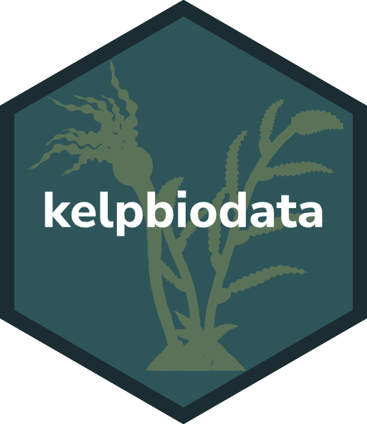

<!-- README.md is generated from README.Rmd. Please edit that file -->

```{r setup, include = FALSE}
knitr::opts_chunk$set(
  collapse = TRUE,
  comment = "#>"
)
```

# kelpbiodata 

<!-- badges: start -->
[](https://github.com/HakaiInstitute/kelpbiodata/actions/workflows/R-CMD-check.yaml)
[](https://lifecycle.r-lib.org/articles/stages.html#experimental)
<!-- badges: end -->

kelpbiodata holds field survey datasets for *Nereocystis luetkeana* and
*Macrocystis pyrifera* from the Hakai Institute in British Columbia, and
reference models fitted to them with the
[kelpbio](https://github.com/HakaiInstitute/kelpbio) package. See the kelpbio
documentation for the models and how to use the fits. Sites are identified by
code (`HAK001`, ...).

## Installation

Install from GitHub:

``` r
# install.packages("pak")
pak::pak("HakaiInstitute/kelpbiodata")
```

## Adding new data to a reference dataset

The data behind each reference fit are exported as
`data_<sheet>_<source>_<species>`, with the columns and column types of
kelpbio's simulated datasets, so new data can be appended with
`dplyr::bind_rows()` and the combined data fitted with the kelpbio function for
that model. `site` and `year` are factors, and bind to factor or character
columns.

```{r, eval = FALSE}
new <- data.frame(
  diameter_mm = c(31, 44, 27),
  weight_kg = c(1.2, 3.1, 0.8),
  site = "MyProgramme:Cove",
  year = "2026"
)
data <- dplyr::bind_rows(kelpbiodata::data_weight_hakai_nereo, new)
fit <- kelpbio::kb_fit_weight_nereo(data)
```

Rows with the same site are the same site: a new year of data at a reference
site, under its code, shares its site effect. A prefix, as in
`"MyProgramme:Cove"`, keeps new sites apart from the reference sites.

## Attribution

`r kelpbiodata::kelpbiodata_attribution()`
The statement is also returned by `kelpbiodata_attribution()`.

## Citation

If you use kelpbiodata in your work, please cite it and the Hakai Institute
data packages its datasets are built from. Use `citation()` to get formatted
citations and BibTeX entries:

```{r citation}
citation("kelpbiodata")
```

## Licensing

Copyright 2026 Tula Foundation.

The code and data are released under the [MIT License](LICENSE.md).
